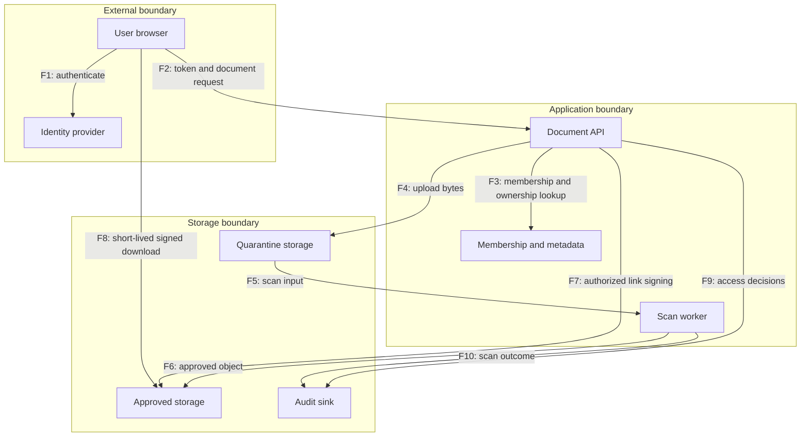

# Case study: Multi-tenant document service

**Type:** fictional architecture review  
**Status:** proposed design; verification not executed  
**Objective:** prevent one customer from accessing another customer's documents while supporting uploads and short-lived downloads.

## Executive summary

The highest-priority design risk is cross-tenant document access. A valid login must never be enough to retrieve a document: the service must verify tenant membership and object ownership on every operation.

The proposed design also quarantines uploads, limits download-link lifetime, separates support privileges, and applies tenant quotas. Before a real release, the team would need evidence that unauthorized access is denied, unscanned files cannot be downloaded, and privileged actions are attributable.

## Scope and assumptions

- A tenant is a customer organization with multiple users.
- Documents may contain confidential business information.
- An external identity provider authenticates users; the service maintains tenant memberships and roles.
- The browser, filenames, document IDs, and requested tenant IDs are untrusted.
- Storage is private. The API issues short-lived download links only after authorization.
- Endpoint compromise, identity-provider internals, billing, and disaster recovery design are outside this exercise.
- The diagram shows logical components, not a deployed cloud configuration.

## Architecture

F1 returns a token to the browser. At F2 the API validates the token's signature, issuer, audience, and lifetime using trusted identity-provider configuration. F7 represents a logical signing operation; an implementation may sign locally using scoped credentials.

| Boundary | Security requirement |
| --- | --- |
| Browser → API | Validate identity, active membership, role, and object ownership; reject client-selected tenant claims that lack server-side membership |
| API → metadata | Scope reads and mutations to the authorized tenant; keep document ownership immutable through ordinary update operations |
| API → quarantine | Enforce upload limits; do not expose quarantined objects through download routes |
| Worker → approved storage | Publish only the exact object version that passed scanning; fail closed on scan failure |
| Browser → approved storage | Signed links are bearer capabilities: restrict object, operation, and lifetime |
| Service → audit sink | Record actor, tenant, object ID, decision, timestamp, and correlation ID; omit tokens, links, and document contents |

## Threat register

Ratings describe the baseline before the proposed controls, using the [repository method](../docs/method.md). Owner roles are illustrative, not assigned people.

| ID | Scenario | Likelihood / impact → priority | Proposed control | Owner role | Verify |
| --- | --- | --- | --- | --- | --- |
| T-01 | An authenticated tenant A user substitutes tenant B's document ID; an ownership check is missing, exposing confidential content | Medium / High → High | Central authorization on list, read, update, delete, and link issuance; tenant-scoped data access | Application engineering | V-01 |
| T-02 | A recipient or log reader obtains a download URL and replays it while valid | Medium / Medium → Medium | Short-lived object-specific links, no URL logging, private storage; use an authenticated proxy if immediate revocation is required | Platform engineering | V-02 |
| T-03 | An authenticated uploader submits malicious content that is published before scanning or replaces a previously scanned version | Medium / High → High | Isolated quarantine; scan exact immutable versions; fail closed; serve downloads as attachments | Application engineering | V-03 |
| T-04 | A compromised support identity uses broad privileges to read customer documents without meaningful oversight | Medium / High → High | No standing content access; time-limited approved elevation; independent audit trail | Security operations | V-04 |
| T-05 | A tenant submits oversized or excessive uploads and consumes shared storage or worker capacity | High / Medium → Medium | Per-tenant size, rate, storage, and concurrency limits; bounded queues and fair scheduling | Platform engineering | V-05 |

T-01 requires an authenticated account and a missing ownership check. T-03 assumes an upload feature and unsafe publication behavior; malware detection is not assumed perfect. T-04 requires compromise of a privileged identity. T-05 is easy to attempt, but the assumed business impact is temporary service degradation rather than a sustained critical outage; revise that rating if availability requirements differ.

**Control state for all rows: Planned.** No residual risk reduction has been measured.

## Architecture decisions

### D-01: Authorize at the API and scope data access by tenant

Related threat: T-01.

The API derives permitted tenant context from verified identity and server-side membership. Document access requires both that membership and ownership by the selected authorized tenant. Database queries include tenant scope.

An alternative is to rely solely on opaque document IDs. Rejected: an identifier is not an authorization mechanism. Database-enforced isolation can add defense in depth, but requires an implementation-specific policy and tests.

Tradeoff: membership lookups and policy consistency add complexity. Membership caches need an explicit revocation strategy. Revisit when shared documents or cross-tenant collaboration are introduced.

### D-02: Use short-lived signed download links

Related threat: T-02.

Illustrative design target: links expire after 60 seconds and authorize a single object version for download. This reduces API bandwidth and permits direct storage delivery.

An authenticated download proxy provides stronger per-request revocation but adds operational load. A signed link may remain usable until expiration after membership is revoked; expiration also may not terminate a download already in progress. Sensitive workflows requiring immediate revocation should select the proxy instead.

Tradeoff: bearer-link leakage remains possible during validity. Revisit if immediate revocation or download-level user attribution becomes mandatory.

### D-03: Separate quarantine from approved content

Related threat: T-03.

The scan worker reads quarantine and writes approved storage. The API can issue links only for approved object versions. Processing is idempotent; duplicate events cannot bypass approval.

An alternative is to scan after publication. Rejected because it leaves a period in which unverified content is available.

Tradeoff: uploads are not immediately downloadable, and scanner outages delay publication. Scanning cannot prove a file harmless. Retain safe content-disposition behavior and restrict active content handling.

## Verification plan

These are proposed procedures for an isolated implementation using synthetic records. **None has been run against a deployed service.**

| ID | Setup and action | Expected outcome | Evidence to retain |
| --- | --- | --- | --- |
| V-01 | Create tenants A and B and one document each. As A, request B's document through list, read, update, delete, and link routes. Repeat after A's membership is revoked | No B content or link returned; no mutation; revoked membership denied within the documented revocation bound | Request/response records, unchanged object state, correlated authorization events |
| V-02 | Issue a link; replay within validity, request after expiry, change object path, and attempt unsigned storage access. Inspect application logs | Replay within validity is possible and documented; new requests after expiry fail; modified and unsigned requests fail; no complete link or credential appears in logs | Timestamped responses and redacted log sample |
| V-03 | Upload a benign fixture and an approved antivirus test fixture in an isolated lab; simulate scanner timeout and duplicate events; attempt a version replacement | Only the exact benign scanned version is published; timeout and rejected files remain unavailable; duplicates do not bypass approval | Object version IDs, scan states, download denials, audit events |
| V-04 | Attempt content access as ordinary support; then exercise an approved temporary elevation and its expiry | Default access denied; elevation has approver, purpose, scope, and expiry; expired privilege denied | Approval record and independently retained audit events |
| V-05 | Exceed configured size, rate, and concurrency limits for tenant A while tenant B submits normal requests | A is rejected or queued within documented bounds; B meets an agreed service target; queues and storage remain bounded | Load profile, tenant-specific latency, quota events, queue depth |

## Residual exposure and release conditions

- Authorized users can still copy downloaded documents.
- Valid signed links can be forwarded before expiry.
- Malware scanning may miss novel or disguised content.
- Compromise of a powerful service identity can exceed ordinary tenant permissions.
- Audit retention and access controls need implementation-specific review.
- Backup isolation and restoration require a separate model.

A real release requires executed verification, resolved failures, an agreed availability target, documented membership-revocation behavior, and an accountable owner's decision on remaining risks. Risk acceptance is **unassigned** in this fictional exercise.
