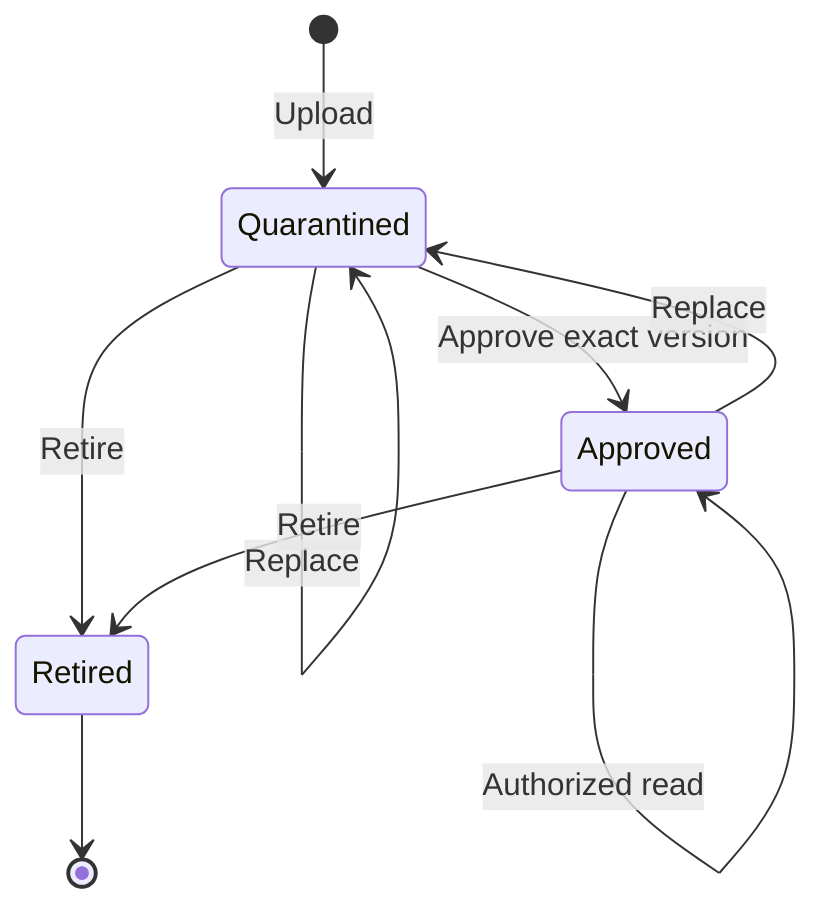

# Security model: Tenant document service

**Model:** SM-01, revision 2  
**Status:** semi-formal specification with explanatory reasoning; not executable or machine-checked  
**System:** fictional service; no customer or employer architecture

## 1. Protection requirements

| ID | Requirement |
| --- | --- |
| R-01 | Human content reads require current reader authorization for the document tenant |
| R-02 | Only the exact approved version is readable |
| R-03 | Content ownership cannot change through document operations |
| R-04 | Membership administration does not itself grant content access |
| R-05 | New read decisions observe committed membership revocations |

This model focuses on authorization and content-state integrity. It does not claim complete confidentiality, malware detection, availability, or implementation security.

## 2. Universe and state

- U: human users.
- T: tenants.
- W: trusted publication workers, distinct from U.
- D: document IDs.
- V: immutable content versions.
- Roles: reader, editor, membership_admin.
- Membership μ ⊆ U × T × Roles.
- Documents δ map each existing document to (tenant, version, status).
- Status ∈ {quarantined, approved, retired}.
- Approval set α ⊆ D × V.
- Content store κ maps versions to immutable bytes.

All IDs and authoritative attributes are server-controlled. Unknown users, documents, roles, or actions deny access. This finite-description specification does not bound the sizes of U, T, D, or V.

## 3. Assumptions and trust

A-01: user identity is authenticated correctly before policy evaluation.  
A-02: workers are trusted to approve only content satisfying the publication procedure. Approval is a workflow assertion, not proof of harmless content.  
A-03: each modeled transition is atomic; reads have a defined authorization point.  
A-04: the content store cannot be accessed directly by users.  
A-05: document tenant and version references cannot be changed outside defined transitions.  
A-06: worker and membership-admin identities are provisioned by a trusted bootstrap process.

The trusted computing base includes identity validation, policy evaluation, membership and document storage, publication workers, and the content delivery path.

## 4. Policy

For user u and document d in state σ:

P-READ(u,d,σ) ⇔ d∈dom(δ) ∧ (u,δ[d].tenant,reader)∈μ ∧ δ[d].status=approved ∧ (d,δ[d].version)∈α.

P-EDIT(u,d,σ) ⇔ d∈dom(δ) ∧ (u,δ[d].tenant,editor)∈μ ∧ δ[d].status≠retired.

P-MANAGE(u,t,σ) ⇔ (u,t,membership_admin)∈μ.

Roles are independent: editor and membership_admin do not imply reader. The policy uses role assignments plus tenant and lifecycle attributes. Every required condition must hold; otherwise deny.

## 5. Transition specification

Unmentioned state fields remain unchanged. Failed preconditions leave state unchanged and release no content.

| Action | Preconditions | Effects |
| --- | --- | --- |
| Upload(u,t,d,v,bytes) | u has editor in t; d and v are fresh | κ[v]=bytes; δ[d]=(t,v,quarantined) |
| Replace(u,d,v,bytes) | P-EDIT; v is fresh | Store bytes; replace version; status=quarantined; remove all approval entries for d; tenant unchanged |
| Approve(w,d,v) | w∈W; d quarantined; v=current version; trusted publication procedure accepts v | Add (d,v) to α; status=approved |
| Read(u,d) | P-READ | Return κ[current version]; no state mutation |
| Retire(u,d) | P-EDIT | status=retired; remove approval entries for d |
| Grant(u,t,x,r) | P-MANAGE; x∈U; r∈{reader,editor} | Add (x,t,r) to μ |
| Revoke(u,t,x,r) | P-MANAGE; r∈{reader,editor} | Remove (x,t,r) from μ |

Membership administrators may grant themselves a reader role in this policy. R-04 separates permissions, but does **not** establish separation of duties or prevent self-grants. A stronger requirement would need a different administrative policy.

Membership-admin assignment and removal are excluded after bootstrap. Retired document IDs cannot be reused. Content versions are immutable, and replacement uses a fresh version.

## 6. Initial state and properties

Init: μ is a valid bootstrapped membership relation; δ, α, and κ are empty.

| ID | Property | Kind |
| --- | --- | --- |
| I-01 | Every approved document has approval for its current version | State invariant |
| I-02 | Every document version references existing immutable content | State invariant plus storage assumption |
| I-03 | Each existing document retains its original tenant through every transition | Transition/history property |
| I-04 | No retired document returns to approved or quarantined | Transition property |
| P-01 | Every human content-release event satisfies P-READ at its authorization point | Event property |
| P-02 | A committed reader revocation denies subsequent reads unless reader permission is granted again | Trace property |

P-02 does not retract previously delivered bytes or cancel a read already authorized before revocation. This distinction is part of the model, not an implementation exception.

## 7. State lifecycle

The final marker indicates the end of the modeled document lifecycle, not deletion of stored bytes. Membership transitions operate independently of document state.

## 8. Preservation argument

Init satisfies I-01 and I-02 vacuously. Upload creates existing content and a quarantined reference. Replace creates content before referencing it, clears approval, and retains the tenant. Approve requires the current version and records that same version. Retire removes readability without changing tenant or content. Read and membership actions do not change document state.

Thus each listed transition preserves the state invariants under the atomicity and immutability assumptions. The transition definitions also preserve tenant ownership and prevent departure from retirement. P-01 follows from Read being the only modeled human release operation and its policy precondition. P-02 follows from evaluating membership in the committed state at each new read decision.

This is a manual explanatory argument. It is not a machine-checked theorem or evidence that a real implementation has no other release path.

## 9. Decision table

Each row assumes an existing object and all other required conditions unless stated otherwise.

| Subject/context | Document | Operation | Decision |
| --- | --- | --- | --- |
| Tenant A reader | A, approved exact version | Read | Permit |
| Tenant A reader only | B, approved exact version | Read | Deny |
| Tenant A editor only | A, approved | Read | Deny |
| Tenant A editor | A, approved | Replace | Permit; approval removed |
| Tenant A reader | A, quarantined | Read | Deny |
| Tenant A membership_admin only | A, approved | Read | Deny |
| Tenant A membership_admin | Tenant B membership | Grant | Deny |
| Revoked A reader, no regrant | A, approved | Read | Deny |
| Trusted worker, stale version | A, quarantined | Approve | Deny |
| Tenant A editor | A, retired | Replace | Deny |

These are expected results, not executed tests.

## 10. Enforcement and evidence obligations

| Property | Enforcement responsibility | Required evidence |
| --- | --- | --- |
| P-01, P-02 | Authenticated delivery path and authoritative membership lookup | Conformance tests, revocation/concurrency review, enumeration of all release paths |
| I-01 | Version-bound publication transaction | State-transition tests, stale-approval rejection |
| I-02 | Immutable storage and transactional metadata updates | Storage configuration and failed-write analysis |
| I-03 | Ownership assigned only during creation | Schema/API review and transition tests |
| I-04 | Lifecycle guard | Retired-state transition tests |

The design uses authenticated content delivery rather than bearer download links. Adding links would introduce transferable capabilities and change the revocation and release properties; it requires an explicit model extension.

## 11. Limits and extensions

No machine execution, deployed-service test, liveness proof, noninterference proof, or compliance assessment is claimed. Future extensions can model delegated sharing, administrative separation of duties, audit durability, deletion, and recovery. Each extension must revisit the requirements, transition relation, and assurance argument.
